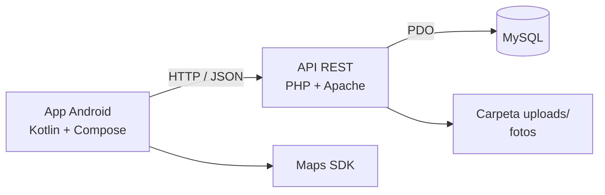

# CitaClara

> Encuentra tu peluquería o barbería, reserva tu cita y descubre cortes, todo desde el móvil.

**CitaClara** (nombre provisional) es una aplicación Android que conecta a **clientes** con **peluquerías y barberías afiliadas**. Los negocios gestionan sus servicios, horarios y citas desde la propia app, y los clientes buscan en un mapa, ven fotos de cortes reales, reservan y guardan sus preferencias en un perfil.

Proyecto intermodular de **2º de Desarrollo de Aplicaciones Multiplataforma (DAM)**, CIFP Virgen de Gracia (Puertollano).

| | |
|---|---|
| **Autor** | Ismael Muñoz Vico |
| **Tutora** | Alicia Velasco Fernandez |
| **Curso** | 2026/2027 |
| **Estado** | En desarrollo (fase inicial) |

---

## Índice

1. [El problema](#el-problema)
2. [La solución](#la-solución)
3. [Funcionalidades](#funcionalidades)
4. [Tecnologías](#tecnologías)
5. [Arquitectura](#arquitectura)
6. [Modelo de datos](#modelo-de-datos)
7. [Análisis de la competencia](#análisis-de-la-competencia)
8. [Seguridad y privacidad](#seguridad-y-privacidad)
9. [Estado del proyecto](#estado-del-proyecto)
10. [Estructura del repositorio](#estructura-del-repositorio)
11. [Puesta en marcha](#puesta-en-marcha)
12. [Documentación](#documentación)
13. [Futuras mejoras](#futuras-mejoras)

---

## El problema

Muchas peluquerías y barberías pequeñas gestionan sus citas con una agenda de papel, WhatsApp y llamadas. Del trabajo del Hub de Emprendimiento del centro (mapa de frustraciones y entrevista de problema a una peluquera autónoma de Puertollano) salieron dos problemas en la **Zona de Oro**, con frecuencia e intensidad iguales o superiores a 4 sobre 5:

| | Frustración | Frecuencia | Intensidad |
|---|---|:---:|:---:|
| F1 | Las citas llegan por WhatsApp, llamadas e Instagram y hay que pasarlas a mano a la agenda; se pierden mensajes. | 5 | 4 |
| F2 | Clientes que no se presentan o cancelan a última hora: el hueco queda vacío y se pierde dinero. | 4 | 5 |

Datos de la entrevista:

- La gestión de mensajes, llamadas y agenda le lleva «una hora al día fácil».
- Cada hueco vacío supone unos 40 o 50 euros, y hay dos o tres cancelaciones por semana.
- Con varias empleadas apuntando en una libreta aparecen citas dobles.
- Ya probó una app gratuita y la abandonó a las dos semanas por ser difícil de configurar.
- Indicó que pagaría entre 20 y 30 € al mes si la herramienta eliminaba de verdad las cancelaciones.

> La validación es provisional: una entrevista completa más conversaciones informales con otros comerciantes. Hay otras dos entrevistas previstas. El lado del cliente (dificultad para encontrar y comparar locales) es una hipótesis pendiente de validar con una encuesta.

## La solución

Una plataforma única con dos tipos de cuenta:

- **Cliente:** busca peluquerías y barberías en lista o mapa, mira fotos de cortes, reserva y guarda sus preferencias.
- **Negocio:** se **afilia**, y gestiona desde la app sus servicios, profesionales, horarios y agenda de citas.

Solo los negocios afiliados y verificados aparecen en el mapa y pueden recibir reservas.

## Funcionalidades

| Usuario | Funcionalidad | Prioridad |
|---|---|---|
| Ambos | Registro e inicio de sesión (correo y contraseña) con un alias visible | Esencial |
| Cliente | Buscador de negocios en lista y **mapa**, con filtros (tipo, servicio, valoración, cercanía) y ficha del negocio | Esencial |
| Cliente | **Reserva de cita**: elegir servicio, profesional y hueco libre; ver y cancelar mis citas | Esencial |
| Cliente | **Galería de cortes** filtrable por categoría, con favoritas | Esencial |
| Cliente | **Perfil**: peluquerías visitadas, favoritos y preferencias | Esencial |
| Negocio | **Afiliación** del negocio (pendiente de verificación) | Esencial |
| Negocio | **Gestión de horarios**: servicios, profesionales con horario propio, bloqueos | Esencial |
| Negocio | **Agenda de citas** sin solapamientos | Esencial |
| Cliente | Valorar un negocio tras la cita | Importante |
| Negocio | Subir fotos de sus trabajos | Importante |
| Cliente | **Recordatorios** de cita en el móvil | Importante |
| Negocio | **Política de cancelación** (horas límite para cancelar) | Importante |
| Ambos | Reportar contenido y eliminar la cuenta | Importante |
| Cliente | «Huecos libres hoy» y botón «Reservar este corte» en las fotos | Deseable |
| Negocio | Estadísticas básicas | Deseable |

**Fuera de alcance:** facturación, cierre de caja, control de stock y pagos.

## Tecnologías

| Ámbito | Tecnología |
|---|---|
| Plataforma | Android |
| Lenguaje | Kotlin |
| Entorno de desarrollo | Android Studio |
| Interfaz | Jetpack Compose |
| Arquitectura | MVVM |
| Conexión con el servidor | Ktor Client |
| Mapa | Maps SDK para Android |
| Servidor (API REST) | PHP con Apache (XAMPP) |
| Base de datos | MySQL (phpMyAdmin) |
| Control de versiones | Git y GitHub |
| Diseño y diagramas | Figma y draw.io |

## Arquitectura

La app Android nunca habla directamente con la base de datos: todo pasa por una API REST en PHP, que valida las peticiones y es la única que accede a MySQL.



## Modelo de datos

Primer esquema, que se irá ajustando durante el desarrollo.

| Tabla | Campos principales |
|---|---|
| `usuario` | id, alias, correo, contraseña (cifrada), tipo (cliente, propietario o empleado), fecha_alta, activo |
| `perfil_cliente` | id_usuario, foto_perfil, ciudad, preferencias |
| `negocio` | id, id_propietario, nombre, descripción, tipo, dirección, latitud, longitud, teléfono, horas_cancelación, estado_afiliación |
| `servicio` | id, id_negocio, nombre, categoría, duración_min, precio |
| `profesional` | id, id_negocio, nombre, activo |
| `horario` | id, id_negocio, día_semana, hora_apertura, hora_cierre, bloqueos |
| `cita` | id, id_cliente, id_negocio, id_servicio, id_profesional, fecha_hora_inicio, fecha_hora_fin, estado |
| `foto` | id, id_negocio, ruta, descripción, categoría, fecha_subida |
| `favorito_negocio` / `favorito_foto` | id_usuario, id_negocio o id_foto, fecha |
| `valoracion` | id, id_cita, id_cliente, id_negocio, puntuación, comentario, fecha |
| `reporte` | id, id_denunciante, tipo_objeto, id_objeto, motivo, fecha, estado |

Las «peluquerías visitadas» del perfil se obtienen de las citas ya realizadas, sin tabla propia.

## Análisis de la competencia

He analizado **Booksy** a partir de su información pública (todavía no he probado la app). Ideas que he tomado y dónde me diferencio:

| Aspecto | Booksy | CitaClara |
|---|---|---|
| Recordatorios y ausencias | Recordatorios automáticos y protección contra ausencias | Notificación local en el móvil del cliente |
| Cancelaciones | Política de cancelación y pagos anticipados | Solo política de cancelación por horas (sin pagos) |
| Reseñas y trabajos | Reseñas verificadas y portfolios | Reseñas solo con cita realizada; galería con «Reservar este corte» |
| Equipo | Disponibilidad por empleado y permisos | Profesionales con horario propio y rol de empleado |
| Enfoque | Generalista (muchas categorías de belleza) | Solo peluquería y barbería, empezando por Puertollano y comarca |
| Clientes sin cita | Sin cola para clientes sin cita previa (según comparativas) | Sección «Huecos libres hoy» |

Pendiente: comprobar cuántos negocios de Puertollano y su comarca hay realmente en esas plataformas.

## Seguridad y privacidad

- Contraseñas cifradas con `password_hash` de PHP y acceso a la API mediante token de sesión.
- Consultas preparadas (PDO) y validación de los datos de entrada, contra inyección SQL.
- Subida de fotos controlada: tipo de fichero, tamaño máximo y archivos renombrados.
- RGPD: datos mínimos, política de privacidad y borrado de cuenta.
- Ubicación solo con permiso del usuario y sin guardar historial de posiciones.
- Derechos de imagen, botón de reportar fotos y afiliación verificada antes de aparecer en el mapa.
- Valoraciones solo de clientes con una cita realizada en ese negocio.

## Estado del proyecto

- [x] Mapa de frustraciones y entrevista de problema
- [x] Propuesta de proyecto
- [x] Primera entrega: situación actual, objetivos y análisis de Booksy
- [ ] Repositorio y proyecto Android creados
- [ ] Base de datos MySQL con las tablas iniciales
- [ ] API en PHP: registro e inicio de sesión
- [ ] Pantalla de login en Compose
- [ ] Afiliación de negocios y gestión de servicios y horarios
- [ ] Buscador con mapa y ficha del negocio
- [ ] Reserva de citas y agenda del negocio
- [ ] Recordatorios y política de cancelación
- [ ] Galería de fotos, favoritos y perfil
- [ ] Pruebas, documentación final y defensa

## Estructura del repositorio

Estructura prevista:

```
CitaClara/
├── app/        # Proyecto Android (Kotlin + Jetpack Compose)
├── api/        # API REST en PHP
├── database/   # Script SQL con las tablas
├── docs/       # Documentación y PDFs de las entregas
└── README.md
```

## Puesta en marcha

Cuando el código esté disponible, los pasos previstos serán:

1. Instalar [XAMPP](https://www.apachefriends.org) y arrancar Apache y MySQL.
2. Importar `database/` en phpMyAdmin.
3. Copiar la carpeta `api/` al directorio `htdocs` de XAMPP.
4. Abrir `app/` en Android Studio y ejecutarla en el emulador. El emulador accede al servidor local en `http://10.0.2.2/`; un móvil real debe estar en la misma red Wi-Fi.

## Documentación

- [Propuesta de proyecto](docs/Propuesta_Proyecto_CitaClara_Ismael_Munoz.pdf)
- [Primera entrega](docs/Primera_Entrega_CitaClara_Ismael_Munoz.pdf)

## Futuras mejoras

- Recordatorios enviados desde el servidor por notificación push o WhatsApp.
- Lista de espera para rellenar huecos liberados.
- Pago o señal al reservar y programa de fidelización.
- Chat entre cliente y negocio.
- Panel web de administración para verificar negocios y moderar contenido.
- Versión multiplataforma (iOS y web), por ejemplo con Kotlin Multiplatform.
- Servidor en internet con HTTPS.
